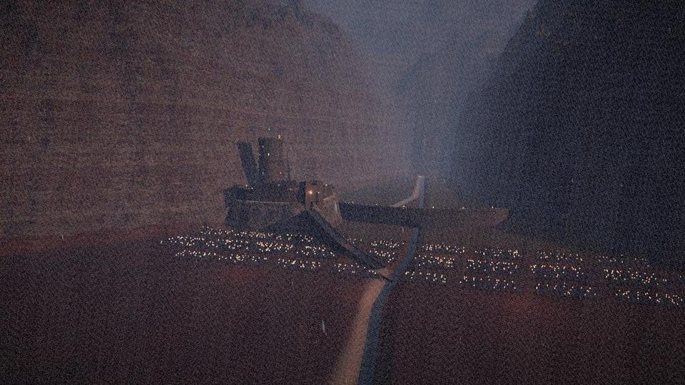
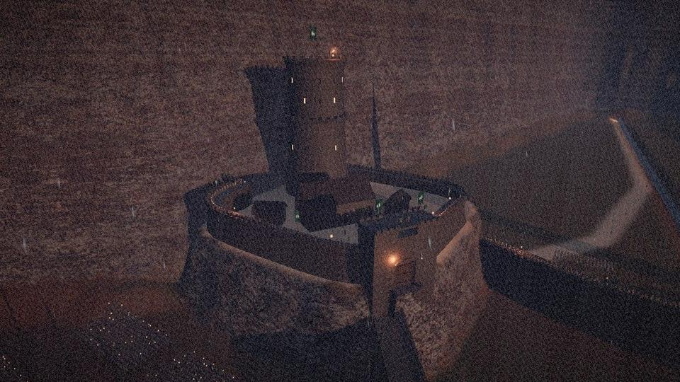
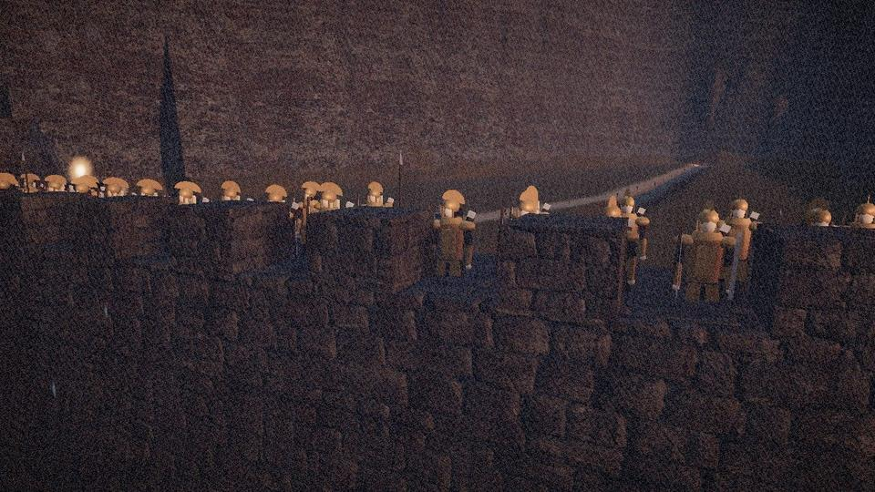
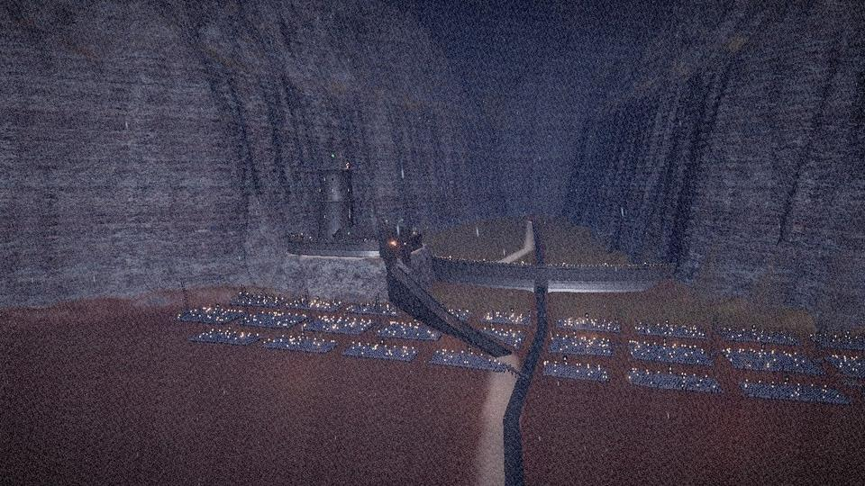

# Middle-earth — a living world

A real-time 3D journey through eleven regions inspired by *The Lord of the
Rings*, built with Three.js. Every landscape, building, tree, and character is
procedural — no downloaded models and no network requests. Helm's Deep adds a
small set of vendored CC0 photo-scanned surface textures (see
`assets/textures/CREDITS.md`).

## Running it

Serve the repository root with any static server and open it:

```
python3 -m http.server 8000
# → http://localhost:8000/
```

(Any static host works — GitHub Pages included. The app is a plain ES-module
page with a local vendored copy of Three.js; no build step, no network
requests.)

Open **`http://localhost:8000/#helmsdeep`** to start directly at Helm's Deep
(any region id works after the `#`).

## The regions

1. **The Shire** — Hobbiton at golden hour: Bag End under its oak, Bagshot Row,
   the Party Tree, the mill and bridge on the Water, chimney smoke, gardens,
   and hobbits about their day — including a wizard arriving by cart.
2. **Bree** — night and rain, lantern pools on wet cobbles, the Prancing Pony,
   hooded townsfolk hurrying, a ranger in the shadows, and a Black Rider.
3. **Rivendell** — an autumn gorge of waterfalls, terraced pavilions, elven
   bridges, drifting gold leaves, and the fair folk on their terraces.
4. **Caradhras** — the Redhorn pass in a blizzard, nine walkers and a pony in
   single file on a knife-edge ledge.
5. **Moria** — the Dwarrowdelf's endless pillars under pale light shafts,
   Balin's tomb, goblin eyes in the dark, and the Bridge of Khazad-dûm:
   a grey wizard, staff raised, before a creature of shadow and flame.
6. **Lothlórien** — Caras Galadhon by night: silver mallorns, spiral stairs,
   lantern-lit talans, niphredil in the sward, and the Lady radiant in white.
7. **Rohan** — Edoras on its rocky crag in a golden grass sea, Meduseld's
   gabled hall, banners of the Mark, and an éored at full gallop.
8. **Helm's Deep** — the night of the storm, before the first arrow: the
   Hornburg on its rock (curtain wall, gatehouse, great hall, and the keep
   with the Horn of Helm), the causeway climbing to the gate, the Deeping Wall
   with its barred culvert, the gorge narrowing to the Glittering Caves, and
   Helm's Dike far out in the coomb. Haldir's Galadhrim in gold scale and the
   last men of the Westfold line the walls; Aragorn, Legolas, Gimli and Haldir
   stand above the culvert, Théoden and Gamling over the gate. Below them
   **ten thousand Uruk-hai** stand in ordered regiments — pike blocks in
   front, shield-wall swordsmen with siege ladders raised, crossbowmen, two
   ballistae, a battering ram at the causeway's foot, the blasting-fire on its
   litters, and the torch-bearing berserker before the culvert — pikes slamming
   the ground in a wave that rolls back through the host, torches guttering in
   the rain, lightning showing the whole army for an instant. Toggle **last
   light** (dusk) ↔ **night storm** with `N`; the **Explore** list glides you
   to eleven vantage points and hands over to free flight.
9. **Isengard** — Orthanc's four-horned crown over a scarred ring of smoking
   fire-pits, felled forests, toiling orcs, and wheeling crebain.
10. **Minas Tirith** — seven white tiers against Mindolluin, the stone keel,
   the White Tree and its guards, the Pelennor patchwork, and Mordor
   smouldering on the horizon.
11. **Mordor** — Orodruin in eruption, lava rivers, marching torch-columns,
    Nazgûl circling Barad-dûr beneath the lidless Eye — and two small figures
    climbing the mountain.

## Controls

| Key | Action |
| --- | --- |
| `1`–`0`, `-` | travel to a region (`8` is Helm's Deep) |
| `T` | the grand tour — every region, every shot, letterboxed |
| `F` | free flight: drag or arrow keys to look, `WASD` fly, `E`/`Q` rise/sink, `Shift` boost, mouse wheel sets cruising speed |
| `N` | Helm's Deep: last light ↔ night storm |
| `H` | hide the interface |

Left-edge dots navigate; each region cycles its cinematic shots when idle.

## How it's built

- `js/engine/` — sky domes with procedural cloud banks, painted mountain-ring
  backdrops, vertex-painted terrain heightfields, instanced trees/grass/rocks,
  water/waterfall/banner/smoke/particle shaders, a procedural character system
  with walk cycles and path-following crowds, cinematic dolly shots on
  Catmull-Rom rails, and a film grade (bloom, per-region color grade,
  vignette, grain).
- `js/regions/` — one module per region: terrain function, palette,
  architecture, atmosphere, inhabitants, and camera shots.
- Helm's Deep adds three engine pieces:
  - `js/engine/army.js` — armies by the thousand. Each soldier type (Uruk
    pikeman, swordsman, crossbowman, torch-bearer, captain, berserker; elven
    archer and swordsman; Rohirrim spearman, bowman and levy) is one merged,
    vertex-coloured mesh whose vertices are tagged by body part, animated on
    the GPU (breathing, glances, cloaks in the wind, the pike-slam). Three
    levels of detail per soldier are re-bucketed by camera distance into
    instance buffers, so ~11,000 figures draw in a few dozen calls.
  - `js/engine/fortify.js` — castle-building: cross-sections swept along
    paths with real-world UVs, battlements, lathe towers, gabled roofs.
  - `js/engine/textures.js` — the vendored CC0 texture sets plus shader
    patches: triplanar rock and two-scale ground blending for the terrain,
    world-space weathering (damp bases, rain streaks, lichen) for masonry,
    and rain-wetness for everything.
- The layout follows the films' design of the fortress: the Hornburg on a
  rock spur, the long causeway to the gate, and the Deeping Wall with its
  culvert. Wētā's notes on the Uruk-hai (uniform black steel, specialised
  troops under crested captains, the White Hand) shaped the host. Film
  summaries set the numbers: ten thousand Uruk-hai against some three
  hundred men and Haldir's company of elves. Bret Devereaux's *A Collection
  of Unmitigated Pedantry* series on the battle informed the defences, such
  as the low, chest-high crenellations.

| | |
| --- | --- |
|  |  |
|  |  |
- Quality was iterated with an automated judge loop: headless screenshots of
  every shot in every region were scored by a panel of film-cinematography
  judge agents against the movies' looks, and their fix lists drove each
  revision round.

Created as a fan work inspired by J.R.R. Tolkien's Middle-earth and its film
adaptations; all geometry and art here are original and procedural.
